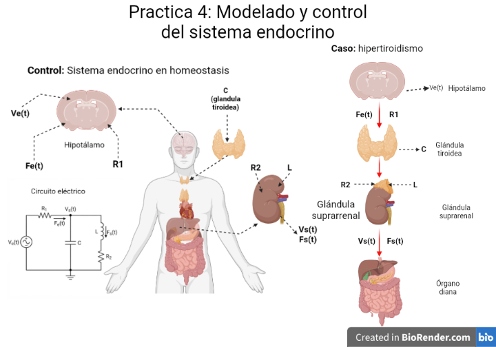
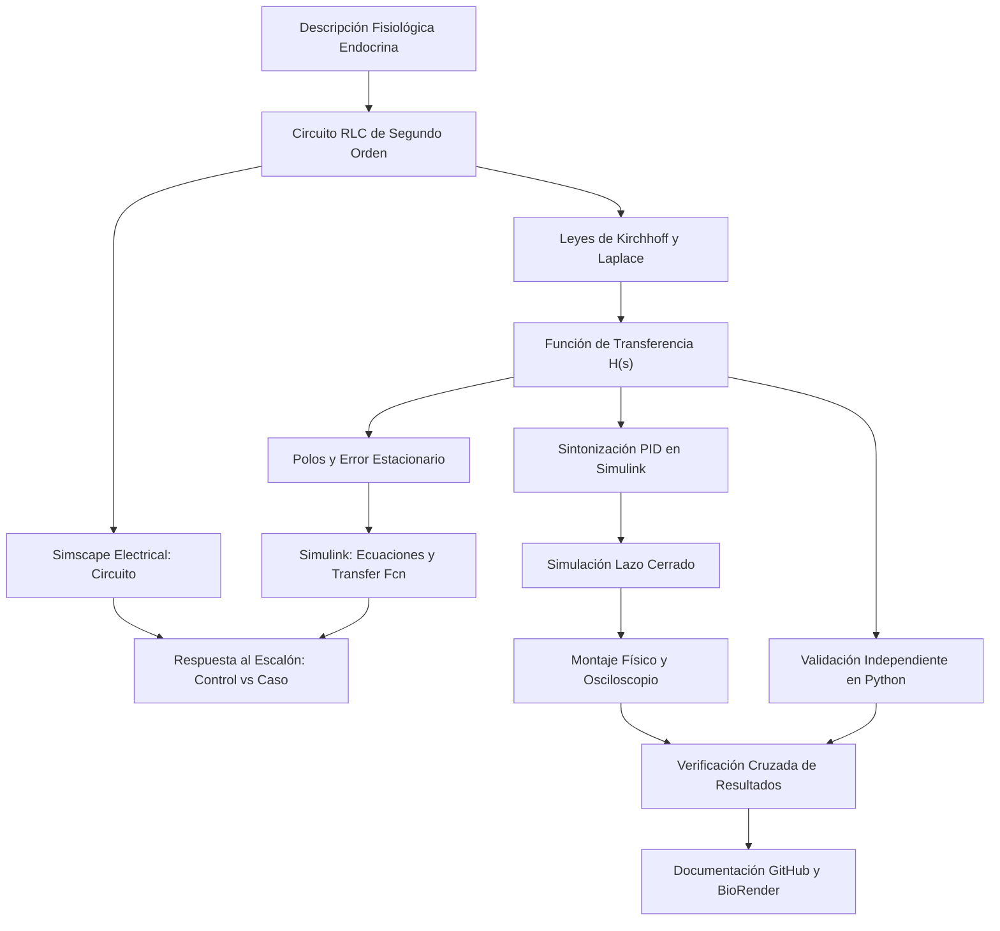

[](https://matlab.mathworks.com/open/github/v1?repo=l23212228-hue/MSFP4)

# Práctica 4 — Modelado y control del sistema endocrino

Repositorio académico de la asignatura **Modelado de Sistemas Fisiológicos**, correspondiente al programa de **Ingeniería Biomédica** del Tecnológico Nacional de México / Instituto Tecnológico de Tijuana. En esta práctica se formula un circuito eléctrico equivalente de segundo orden para representar los procesos fenomenológicos de secreción, transporte, almacenamiento y respuesta hormonal. Se evalúa una condición de referencia (*control*) frente a una condición alterada (*caso*), se diseña un controlador PID *in silico* y se contrastan los resultados computacionales con las mediciones experimentales en el Laboratorio de Electrónica.

**Docente:** Dr. Paul Antonio Valle Trujillo  
**Correo:** paul.valle@tectijuana.edu.mx  
**Departamento:** Departamento de Ingeniería Eléctrica y Electrónica  
**Institución:** Tecnológico Nacional de México / Instituto Tecnológico de Tijuana  
**Asignatura:** Modelado de Sistemas Fisiológicos  
**Programa:** Ingeniería Biomédica  
**Estudiante:** Reyes Zamudio Mariant · 23212228 · l23212228@tectijuana.edu.mx  

**Sede:** Blvd. Alberto Limón Padilla s/n, Tijuana, C. P. 22454, B. C., México.

---

<a id="contenido"></a>
## Contenido

1. [Resumen](#resumen)
2. [Competencia y objetivos](#objetivos)
3. [Relación con el temario](#temario)
4. [Modelo físico y analogía eléctrica](#analogia)
5. [Formulación matemática](#modelo)
6. [Análisis de estabilidad y error en estado estacionario](#analisis)
7. [Parámetros del sistema (Control vs. Caso)](#parametros)
8. [Implementación en MATLAB, Simulink y Simscape Electrical](#matlab)
9. [Control en lazo cerrado y sintonización PID](#pid)
10. [Reproducción en Python](#python)
11. [Implementación experimental y osciloscopio](#laboratorio)
12. [Resultados y verificación cruzada](#resultados)
13. [Flujo de trabajo](#flujo)
14. [Actividades del estudiante](#actividades)
15. [Estructura del repositorio](#estructura)
16. [Requisitos](#requisitos)
17. [Referencias](#referencias)

---

<a id="resumen"></a>
## Resumen

La dinámica endocrina regula procesos fisiológicos mediante la liberación, circulación y captación de hormonas en órganos diana. En este trabajo se construye un modelo fenomenológico de segundo orden mediante una red RLC donde $V_e(t)$ representa el estímulo neural/metabólico de secreción, $R_1$ modela las pérdidas de transporte, $C$ representa la acumulación temporal de la hormona y la rama en serie $L$ - $R_2$ describe la inercia y eliminación en el tejido diana.

Se analiza el comportamiento ante una entrada escalón unitario $V_e(t) = u(t)$ comparando un individuo sano (*control*) con una condición patológica (*caso*) generada al alterar $C$ y $R_2$. Posteriormente, se sintoniza un **controlador PID** para restaurar la respuesta hormonal normal y se validan los resultados de forma cruzada mediante ecuaciones integro-diferenciales en Simulink, Simscape Electrical, código en Python y montaje físico en protoboard medido con osciloscopio.

**Palabras clave:** sistema endocrino; circuito RLC; controlador PID; analogía eléctrica; MATLAB; Simulink; Simscape Electrical; Python; instrumentación electrónica.

[Volver al contenido](#contenido)

---

<a id="objetivos"></a>
## Competencia y objetivos

### Competencia a desarrollar

Modeliza sistemas fisiológicos mediante analogías eléctricas, ecuaciones diferenciales y funciones de transferencia para analizar su comportamiento dinámico y diseña estrategias de control mediante técnicas de control clásico. Interpreta una descripción simplificada de los procesos de secreción, transporte, almacenamiento y respuesta hormonal para proponer un circuito equivalente de segundo orden, comparar una condición de referencia (*control*) con una alterada (*caso*), diseñar un controlador PID y contrastar los resultados analíticos, computacionales y experimentales en el Laboratorio de Electrónica.

### Objetivos específicos

1. Proponer la topología del circuito eléctrico equivalente de segundo orden a partir de las hipótesis fisiológicas del sistema endocrino.
2. Formular el sistema de ecuaciones integro-diferenciales y obtener la función de transferencia $H(s) = V_s(s)/V_e(s)$.
3. Calcular los polos del sistema y determinar el error en estado estacionario ($e_{ss}$) ante una entrada escalón unitario para las condiciones *control* y *caso*.
4. Emular la respuesta en lazo abierto en Simulink, Simscape Electrical y Python durante $t \in [0, 10]\text{ s}$.
5. Sintonizar las ganancias ($k_P, k_I, k_D$) de un controlador PID en Simulink para minimizar el error $e(t) = V_{s,\text{control}}(t) - V_{s,\text{caso}}(t)$.
6. Construir físicamente los circuitos *control*, *caso* y el controlador analógico con amplificadores operacionales para verificar las respuestas en el osciloscopio.
7. Elaborar un diagrama biológico en BioRender que relacione las estructuras endocrinas con los elementos eléctricos del modelo *(pendiente)*.

[Volver al contenido](#contenido)

---

<a id="temario"></a>
## Relación con el temario

Esta práctica integra contenidos de la asignatura **Modelado de Sistemas Fisiológicos (IBF-1020)**:

| Unidad | Área | Contenidos aplicados |
|---|---|---|
| I | Sistemas de control retroalimentados | Respuesta al escalón, análisis de error estacionario, ubicación de polos y retroalimentación negativa. |
| II | Modelado matemático | Analogías fenomenológicas RLC, ecuaciones integro-diferenciales y funciones de transferencia de segundo orden. |
| III | Controladores | Diseño y sintonización de controladores PID y realización analógica mediante amplificadores operacionales. |

[Volver al contenido](#contenido)

---

<a id="analogia"></a>
## Modelo físico y analogía eléctrica

El circuito equivalente consta de una fuente de voltaje $V_e(t)$ en serie con $R_1$, conectada a un nodo central donde se mide la salida $V_s(t)$. De dicho nodo se derivan dos ramas en paralelo hacia referencia: un capacitor $C$ y una rama en serie formada por un inductor $L$ y un resistor $R_2$.

| Variable o proceso fisiológico | Representación eléctrica | Interpretación dentro del modelo |
|---|---|---|
| Estímulo para la secreción hormonal | $V_e(t)$ | Señal de entrada que activa la respuesta del sistema endocrino. |
| Flujo de secreción y transporte | $F_e(t) = i_1(t)$ | Corriente asociada con la transferencia desde la fuente hacia el compartimento. |
| Pérdidas y oposición en transporte | $R_1$ | Resistencia que retarda o reduce la transmisión de la señal hormonal. |
| Acumulación temporal de hormona | $C$ | Capacitancia que almacena temporalmente la hormona antes de su uso. |
| Retardo o inercia del tejido diana | $L$ | Inductancia que opone resistencia dinámica a cambios rápidos en la respuesta. |
| Utilización o eliminación de señal | $R_2$ | Resistencia asociada con la disipación o consumo en el órgano diana. |
| Flujo de respuesta del tejido diana | $F_s(t) = i_2(t)$ | Corriente correspondiente a la rama de respuesta del órgano diana. |
| Nivel hormonal efectivo | $V_s(t)$ | Voltaje de salida normalizado disponible en el compartimento de interés. |

[Volver al contenido](#contenido)

---

<a id="modelo"></a>
## Formulación matemática

### 1. Ecuaciones integro-diferenciales

Aplicando las leyes de Kirchhoff a las dos mallas del circuito con corrientes $i_1(t) = F_e(t)$ e $i_2(t) = F_s(t)$:

$$V_e(t) = R_1 i_1(t) + \frac{1}{C} \int \left[ i_1(t) - i_2(t) \right] dt$$

$$-\frac{1}{C} \int \left[ i_1(t) - i_2(t) \right] dt + L \frac{di_2(t)}{dt} + R_2 i_2(t) = 0$$

$$V_s(t) = L \frac{di_2(t)}{dt} + R_2 i_2(t)$$

### 2. Función de Transferencia $H(s)$

Aplicando la Transformada de Laplace con condiciones iniciales nulas y sustituyendo $i_1(s) = (L C s^2 + R_2 C s + 1) i_2(s)$:

$$\boxed{H(s) = \frac{V_s(s)}{V_e(s)} = \frac{L s + R_2}{(L C R_1) s^2 + (C R_2 R_1 + L) s + (R_1 + R_2)}}$$

El denominador es de segundo orden debido a los dos elementos independientes de almacenamiento de energía ($C$ y $L$).

[Volver al contenido](#contenido)

---

<a id="analisis"></a>
## Análisis de estabilidad y error en estado estacionario

### 1. Polos del sistema y Estabilidad

La ecuación característica $(L C R_1) s^2 + (C R_2 R_1 + L) s + (R_1 + R_2) = 0$ arroja dos polos reales negativos distintos para ambos casos, confirmando que ambos sistemas son **estables y sobreamortiguados**:

* **Control (Sano):** $\lambda_1 = -1009.76$, $\lambda_2 = -999999.62$
* **Caso (Alterado):** $\lambda_1 = -2.0$, $\lambda_2 = -1000.0$

### 2. Error en Estado Estacionario ($e_{ss}$)

Ante una entrada escalón unitario $V_e(s) = 1/s$, aplicando el teorema del valor final:

$$e_{ss} = \lim_{s \to 0} s V_e(s) \left[ 1 - H(s) \right] = 1 - \frac{R_2}{R_1 + R_2}$$

* **Error en Control:** $e_{ss,\text{control}} = 1 - \frac{100\text{ k}\Omega}{1\text{ k}\Omega + 100\text{ k}\Omega} \approx 0.0099\text{ V}$ (Salida final $\approx 0.99\text{ V}$)
* **Error en Caso:** $e_{ss,\text{caso}} = 1 - \frac{1\text{ k}\Omega}{1\text{ k}\Omega + 1\text{ k}\Omega} = 0.5\text{ V}$ (Salida final $= 0.5\text{ V}$)

[Volver al contenido](#contenido)

---

<a id="parametros"></a>
## Parámetros del sistema (Control vs. Caso)

La alteración endocrina (*caso*) se modela incrementando la capacidad de almacenamiento ($C$) y reduciendo la resistencia de eliminación ($R_2$):

| Componente | Descripción | Control (Sano) | Caso (Alterado) | Unidades |
|---|---|:---:|:---:|:---:|
| $R_1$ | Resistencia de transporte | $1$ | $1$ | $\text{k}\Omega$ |
| $L$ | Inertancia de respuesta | $100$ | $100$ | $\text{mH}$ |
| $C$ | Almacenamiento hormonal | $1$ | $1000$ | $\mu\text{F}$ |
| $R_2$ | Disipación en tejido diana | $100$ | $1$ | $\text{k}\Omega$ |

[Volver al contenido](#contenido)

---

<a id="matlab"></a>
## Implementación en MATLAB, Simulink y Simscape Electrical

En MATLAB/Simulink (`Reyes23212228.mlx` y `sistema.slx`) se configuró el solucionador rígido `ode15s` con paso máximo de $1\times 10^{-3}\text{ s}$ en un horizonte de simulación $t \in [0, 10]\text{ s}$ para contrastar las tres implementaciones: ecuaciones integro-diferenciales, función de transferencia y red eléctrica en Simscape Electrical.

[Volver al contenido](#contenido)

---

<a id="pid"></a>
## Control en lazo cerrado y sintonización PID

Para eliminar el error estacionario de $0.5\text{ V}$ del caso alterado y lograr que siga la referencia del individuo sano ($V_{s,\text{control}} \approx 0.99\text{ V}$), se implementó un controlador PID en retroalimentación negativa sintonizado mediante la herramienta **PID Tuner** de Simulink:

| Parámetro del Controlador | Valor Sintonizado (*Tuned*) | Valor en Bloque (*Block*) |
|---|:---:|:---:|
| Ganancia Proporcional ($k_P$) | $2136.7$ | $2048.1477$ |
| Ganancia Integral ($k_I$) | $845541.5502$ | $776909.6853$ |
| Ganancia Derivativa ($k_D$) | $0.18114$ | $0.18114$ |
| Coeficiente de Filtro ($N$) | $8170.399$ | $7831.7903$ |

**Desempeño en lazo cerrado:** Tiempo de subida ($t_r$) de $0.809\text{ ms}$, tiempo de establecimiento ($t_s$) de $6.19\text{ ms}$ y sobreimpulso del $10.2\%$.

[Volver al contenido](#contenido)

---

<a id="python"></a>
## Reproducción en Python

Mediante Visual Studio Code y Python se implementaron las funciones de transferencia $H_{\text{control}}(s)$ y $H_{\text{caso}}(s)$ y el lazo cerrado con el controlador PID sintonizado. Las simulaciones numéricas en el intervalo $t \in [0, 10]\text{ s}$ confirmaron una concordancia exacta con las gráficas generadas en MATLAB (`Grafica matlab.pdf` vs. `Grafica python.png`).

[Volver al contenido](#contenido)

---

<a id="laboratorio"></a>
## Implementación experimental y osciloscopio

Se construyeron físicamente los circuitos equivalentes en protoboard utilizando componentes comerciales y amplificadores operacionales para el controlador analógico. Al excitar el sistema con una señal escalón periódica de $1\text{ V}_{pp}$ en el generador de funciones y registrar las señales en el osciloscopio digital OWON:

* **Canal 1 (Amarillo):** Señal de entrada $V_e(t)$ ($V_{pp} = 1.08\text{ V}$).
* **Canal 2 (Azul):** Respuesta del *caso* en lazo abierto estabilizándose en la mitad de amplitud ($V_{pp} = 520.0\text{ mV} \approx 0.5\text{ V}$).
* **Canal 4 (Verde):** Respuesta del sistema controlado en lazo cerrado ($PID(t)$) siguiendo fielmente la referencia unitaria.

[Volver al contenido](#contenido)

---

<a id="resultados"></a>
## Resultados y verificación cruzada

Se verificó la consistencia dinámica entre todas las plataformas analíticas, computacionales y experimentales:

| Evidencia / Entregable | Archivo en el repositorio | Estado |
|---|---|---|
| Desarrollo analítico y polos | `Analisis matemático endocrino .pdf` | Completado |
| Cuaderno computacional MATLAB | `Reyes23212228.mlx` / `Reyes23212228.pdf` | Completado |
| Gráfica comparativa MATLAB | `Grafica matlab.pdf` | Completado |
| Gráfica comparativa Python | `Grafica python.png` | Completado |
| Sintonización PID Tuner | `PID.png` | Completado |
| Captura experimental osciloscopio | `osciloscopio.png` | Completado |
| Diagrama biológico endocrino | `diagrama_biologico.png` | Pendiente |

[Volver al contenido](#contenido)

---

<a id="flujo"></a>
## Flujo de trabajo



[Volver al contenido](#contenido)

---

<a id="actividades"></a>
## Actividades del estudiante

- [x] **Análisis matemático:** Deducción de ecuaciones integro-diferenciales, $H(s)$, polos y $e_{ss}$.
- [x] **Cuaderno MATLAB y Simulink:** Implementación de modelos y sintonización con PID Tuner (`Reyes23212228.mlx`).
- [x] **Validación en Python:** Simulación de respuestas al escalón en lazo abierto y cerrado (`Grafica python.png`).
- [x] **Práctica de laboratorio:** Montaje en protoboard y captura de señales en osciloscopio.
- [ ] **Diagrama biológico:** Elaboración del esquema endocrino en BioRender *(pendiente)*.
- [ ] **Resguardo final:** Actualización de diagramas y `CITATION.cff` en GitHub.

[Volver al contenido](#contenido)

---

<a id="estructura"></a>
## Estructura del repositorio

```text
.
├── README.md                             # Reporte principal de la práctica
├── CITATION.cff                          # Fichero de citación del repositorio
├── Reyes23212228.mlx                     # Cuaderno computacional de MATLAB
├── Reyes23212228.pdf                     # Exportación PDF del cuaderno MATLAB
├── sistema.slx                           # Modelos en Simulink y Simscape Electrical
├── modelo_endocrino.py                   # Script de validación en Python
├── Analisis matemático endocrino .pdf    # Desarrollo analítico manuscrito
├── Grafica matlab.pdf                    # Gráfica comparativa generada en MATLAB
├── Grafica python.png                    # Gráfica comparativa generada en Python
├── PID.png                               # Captura de parámetros en PID Tuner
├── osciloscopio.png                      # Captura experimental del osciloscopio
└── diagrama_biologico.png                # Diagrama en BioRender
```

[Volver al contenido](#contenido)

---

<a id="requisitos"></a>
## Requisitos

### Software

- **MATLAB R2023b o superior** con Simulink, Control System Toolbox y Simscape Electrical.
- **Python 3.10+** con las librerías `numpy`, `scipy` y `matplotlib`.
- **Visual Studio Code** para ejecución de scripts `.py`.

### Hardware de Laboratorio

- Resistores comerciales ($1\,\text{k}\Omega$, $100\,\text{k}\Omega$), capacitores ($1\,\mu\text{F}$, $1000\,\mu\text{F}$) e inductor ($100\,\text{mH}$).
- Amplificadores operacionales para el controlador analógico PID, fuente simétrica $\pm 15\,\text{V}$, generador de funciones y osciloscopio digital.

[Volver al contenido](#contenido)

---

<a id="referencias"></a>
## Referencias

[1] M. C. Khoo, *Physiological Control Systems: Analysis, Simulation, and Estimation*, 2nd ed. Piscataway, NJ, USA: IEEE Press, 2018.

[2] F. C. Hoppensteadt and C. S. Peskin, *Modeling and Simulation in Medicine and the Life Sciences*, Springer.

[3] J. E. Hall, *Guyton and Hall Textbook of Medical Physiology*, 14th ed. Philadelphia, PA, USA: Elsevier, 2021.

[4] K. Ogata, *Ingeniería de Control Moderna*, 5a ed. Madrid, España: Pearson Educación, 2010.

[5] N. S. Nise, *Control Systems Engineering*, 8th ed. Hoboken, NJ, USA: John Wiley & Sons, 2020.

[6] P. A. Valle, *Syllabus para Modelado de Sistemas Fisiológicos*, Tecnológico Nacional de México / Instituto Tecnológico de Tijuana, Tijuana, B.C., México, 2026. Permalink: https://biomath.xyz/course/

[7] Tecnológico Nacional de México, *Programa de estudio de la asignatura Modelado de Sistemas Fisiológicos*, IBF-1020.
